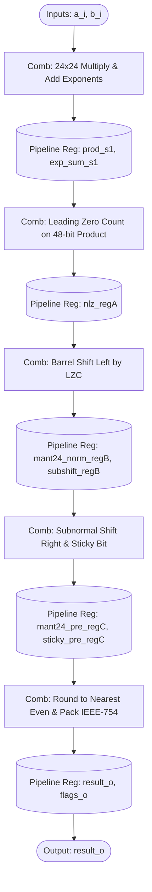
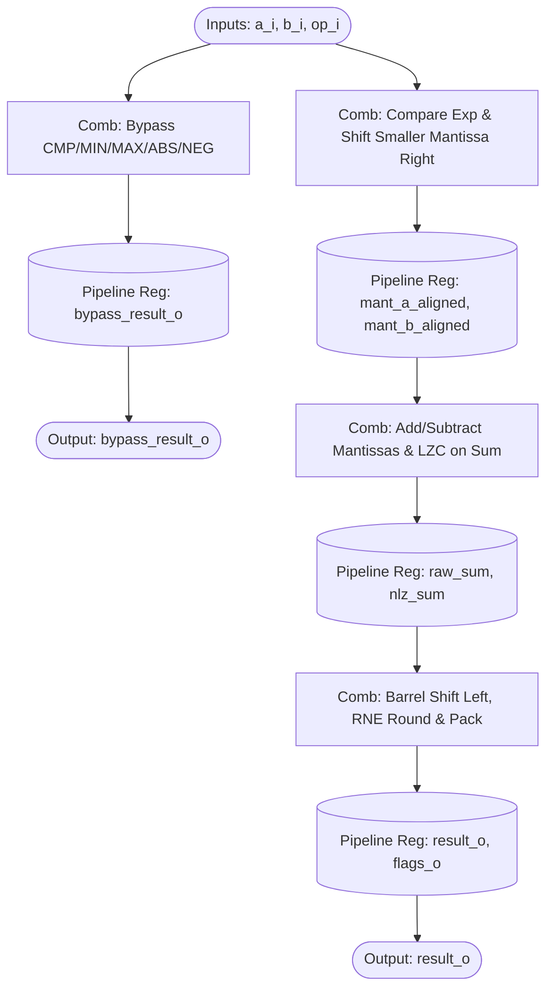
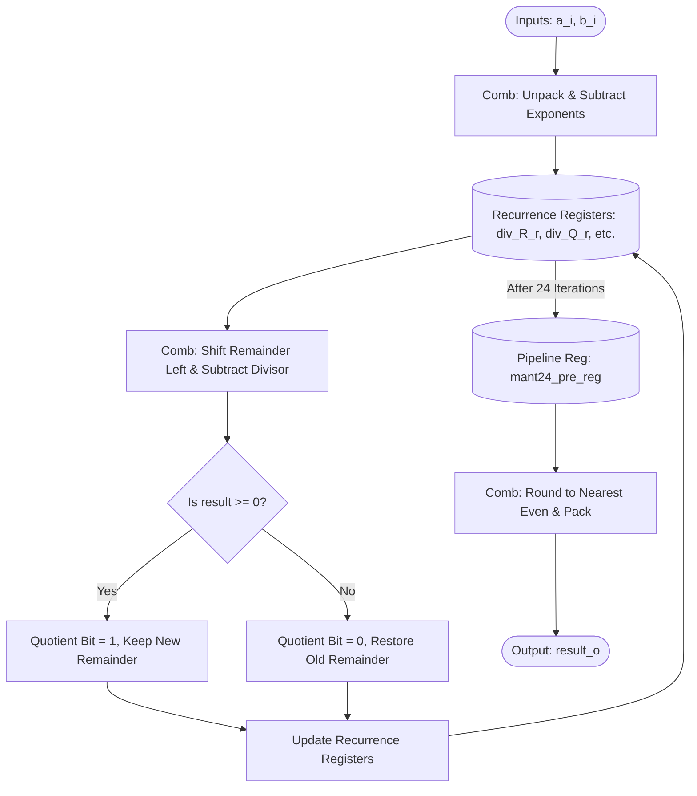
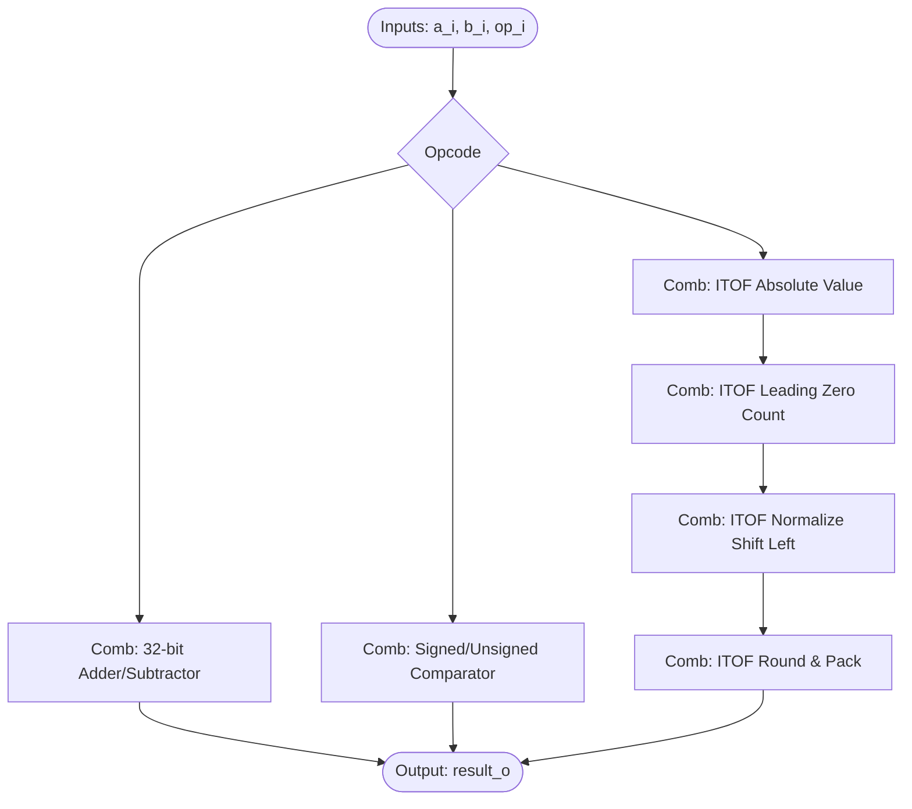

# IEEE-754 Binary32 Arithmetic Core

A from-scratch IEEE-754 single-precision floating-point arithmetic unit in 
SystemVerilog, with a verification environment that cross-checks it against 
Berkeley SoftFloat. Its multiplier and adder meet a 100 MHz post-route timing constraint in Vivado on an Artix-7 target; the divide/square-root unit's final report still shows a violation (see below). It has been simulated and implemented, not run on a board.

Each module is a self-contained datapath: operands in, result out, no 
dependency on any CPU, bus, or surrounding system. All design documentation 
is entirely contained within this README.

## What's in it

| Module | What it does | Latency |
|---|---|---|
| `rtl/fpu_mul.sv` | Multiplier, heavily pipelined into 5 stages | 5 cycles |
| `rtl/fpu_add.sv` | Adder/subtractor, 3-stage pipeline | 3 cycles |
| `rtl/fpu_add.sv` (bypass) | CMP, MIN, MAX, ABS, NEG, MOV sharing the adder | 1 cycle |
| `rtl/fpu_divsqrt.sv` | Radix-2 digit-recurrence divide and square root | Fixed: 29 (div) / 28 (sqrt) |
| `rtl/fpu_intalu.sv` | Integer ALU and int32 to binary32 conversion | Combinational |

For my design choices, I kept it simple: round-to-nearest-even only; 
subnormals fully supported (no flush-to-zero); every NaN canonicalizes to 
`0x7FC00000` (payloads are not propagated); multiply and add are separate units 
with independent rounding; divide/sqrt uses its own digit-recurrence 
datapath.

---

## Physical Implementation & Timing Closure

I pushed this core through Vivado physical synthesis and implementation to 
measure whether it can meet a real clock constraint. This is implementation timing evidence, not a board test. I targeted the slow **Xilinx Artix-7 -1L 
speed grade (xc7a12ticsg325-1L)** at a rigid **100MHz (10ns period)** constraint. 

- **fpu_mul**: The original datapath (due to a 48-bit Leading Zero Counter feeding 
  a 48-bit Barrel Shifter) took over 22ns. I architected a strict 5-stage pipeline 
  to separate the LZC and the shifter into distinct cycles, cleanly passing 
  post-route timing with a positive WNS.
- **fpu_divsqrt**: The digit recurrence engine was fast enough, but the final RNE 
  rounding block took almost 17ns. I added a pipeline register immediately before 
  the final rounding adder (`mant24_pre_reg`), increasing the latency from 28 to 29 
  cycles, and completely isolating the recurrence loop. The final report (`canonical_results/fpu_divsqrt_timing.txt`) 
  still shows a worst setup slack of -1.642 ns across 34 failing endpoints; the worst path runs from the `a_i` 
  input port through the operand-setup logic into the recurrence registers, so the recurrence loop itself is not the limiter.
- **fpu_add**: meets the constraint (setup +0.100 ns, hold +0.163 ns). **fpu_mul**: setup +0.346 ns, hold +0.083 ns.
- **fpu_intalu**: purely combinational, so it has no clocked paths to time.

---

## Module Architectures & Step-by-Step Analysis

### 1. Multiplier (`fpu_mul.sv`)

The multiplier uses a strict 5-stage pipeline to handle subnormal inputs, large 
barrel shifts, and Round-to-Nearest-Even (RNE) logic while maintaining 100MHz 
timing on slow FPGA fabric.



**Step-by-step flow:**
1. **Stage 1 (Multiply)**: The 32-bit floats are unpacked into sign, exponent, and mantissa. The hidden '1' is restored. Exponents are added (and the bias is subtracted). The 24-bit mantissas are multiplied to form a 48-bit raw product.
2. **Stage 2 (LZC)**: A Leading Zero Counter determines exactly how many bits the 48-bit product must be shifted left to reach a normalized state (MSB = 1).
3. **Stage 3 (Normalize)**: A barrel shifter takes the LZC output and shifts the 48-bit product to align the mantissa.
4. **Stage 4 (Subnormal)**: If the calculated exponent drops below 1 (subnormal), a right-shift is applied to denormalize the result. All shifted-out bits are OR'd together to form the "sticky bit" for exact rounding.
5. **Stage 5 (Round)**: The guard, round, and sticky bits evaluate whether to increment the mantissa (RNE). Finally, the components are packed back into a 32-bit IEEE-754 float.

### 2. Adder/Subtractor (`fpu_add.sv`)

The adder is a 3-stage pipeline. Because floats must have matching exponents before addition, the mantissas must be aligned first. It also includes a 1-cycle bypass path for simple logical operations.



**Step-by-step flow:**
1. **Stage 1 (Alignment)**: The exponents are compared. The operands are logically swapped so the larger absolute value is on top. The difference between the exponents dictates how far the smaller mantissa is shifted right to align the binary points.
2. **Stage 2 (Add)**: The aligned mantissas are added (or subtracted, depending on the signs and the requested operation). Because massive cancellation can occur during subtraction, an LZC immediately inspects the raw sum.
3. **Stage 3 (Normalize)**: The sum is shifted left based on the LZC to normalize it. The guard/round/sticky bits dictate the RNE rounding step, and the final 32-bit float is packed.
4. **Bypass Path**: For CMP, MIN, MAX, ABS, and NEG, the Stage 1 exponent/mantissa comparator directly triggers multiplexers that output the result in a single cycle without traveling through the addition pipeline.

### 3. Divide / Square Root (`fpu_divsqrt.sv`)

This module uses a Radix-2 Restoring Digit-Recurrence algorithm. It is not fully pipelined (it cannot accept 1 op/cycle), but it has a fixed multi-cycle latency.



**Step-by-step flow:**
1. **Setup**: The exponents are subtracted, and the operands are unpacked.
2. **Recurrence Loop (24 cycles)**: Much like long division by hand, the remainder is shifted left, and the divisor is subtracted. If the result is positive, the current quotient bit is 1, and the new remainder is kept. If negative, the quotient bit is 0, and the old remainder is restored. This repeats 24 times to extract the 24-bit mantissa.
3. **Staging Register**: To prevent timing violations, the raw 24-bit quotient and sticky bit are securely registered in a pipeline stage before rounding.
4. **Finalize**: The registered quotient is rounded (RNE) and packed with the final exponent and sign.

### 4. Integer ALU (`fpu_intalu.sv`)

A single-cycle combinational ALU handling basic integer operations and the complex Integer-to-Float (ITOF) conversion.



**Step-by-step flow (ITOF focus):**
1. **Absolute Value**: The 32-bit signed integer is converted to an absolute (positive) magnitude.
2. **LZC & Normalize**: An LZC finds the Most Significant Bit (MSB). The magnitude is shifted left so the MSB sits exactly at the IEEE-754 hidden bit position.
3. **Rounding**: Because a 32-bit integer can have up to 32 bits of precision, but a binary32 float only holds 24 bits of mantissa, precision can be lost. The lower bits are used to calculate Round-to-Nearest-Even (RNE).
4. **Pack**: The 8-bit exponent is calculated mathematically based on the LZC result, combined with the rounded mantissa and the original integer sign.

---

## Verification

I wrote two layers of verification, run by a single script:

```bash
python3 tb/run_verify.py --vectors 3000000
```

1. **Random cross-check against Berkeley SoftFloat** (Verilator + C++). I 
   compare ADD/SUB, MUL, DIV/SQRT, and ITOF bit-for-bit against SoftFloat on 
   random operands heavily biased toward zeros, infinities, NaNs, and 
   subnormals. The DIV/SQRT run also strictly verifies the fixed latency on 
   every single vector.
2. **Directed testbenches** (Icarus) for specific corner cases, edge conditions, 
   and bypass operations.

Requires `verilator`, `iverilog`, `g++`, and network access to fetch and
build SoftFloat on first run.

### Latest result (clean run from this tree)

| Check | Result |
|---|---|
| MUL, ADD/SUB, DIV/SQRT, ITOF random vs SoftFloat | 3,000,000 vectors each (12,000,000 total), 0 mismatches |
| DIV/SQRT latency on random vectors | 0 cycle mismatches |
| Directed: MUL / ADD+bypass / DIV+SQRT / IntALU | 12 / 23 / 12 / 16 passed, 0 failed |

### What is and isn't covered by the random layer

SoftFloat implements add, sub, mul, div, sqrt and int-to-float, so those get 
the large random cross-check. It does not implement CMP, MIN, MAX, ABS, NEG 
or MOV, and the integer IADD/ISUB/ICMP/IMOV operations are not in the random 
harness either. For those, I rely exclusively on directed tests. This is a 
real difference in verification depth compared with the core arithmetic.

### SystemVerilog Assertions (SVA)

In addition to Verilator/Icarus simulation, I bound formal-friendly SVA 
properties directly into the RTL to constantly monitor pipeline health and 
IEEE-754 corner cases during operation. Key properties checked:

- **Strict Pipeline Latencies**: Ensuring `valid_o` tracks `valid_i` by exactly 
  3 cycles (ADD), 5 cycles (MUL), and 1 cycle (bypass).
- **Divider State Machine**: Ensuring `DIV` finishes in exactly 29 cycles, 
  `SQRT` in 28 cycles, and that `busy_o` / `done_o` handshaking never violates 
  protocol.
- **Hardware Corner Cases**: Immediate checks for structural IEEE-754 math rules, 
  e.g., `0 * inf = NaN`, `inf - inf = NaN`, canonicalization of NaNs, and 
  division by zero.
- **Asynchronous Resets**: Ensuring valid flags and state machines reset safely.

## Known limitations

- Only round-to-nearest-even is implemented; there are no other IEEE rounding modes.
- NaN payloads are canonicalized, not propagated, and signaling NaNs do not trap. This is a documented simplification of full IEEE-754.
- Verification depth is uneven: `flags_o` is checked only by the directed tests, never in the random SoftFloat comparison.
- The multiplier's mantissa multiply is behavioral and is pushed directly through DSP slices during physical synthesis.
